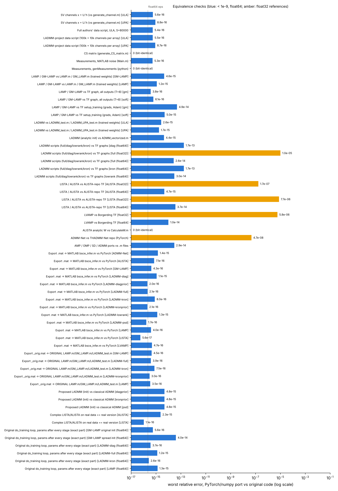
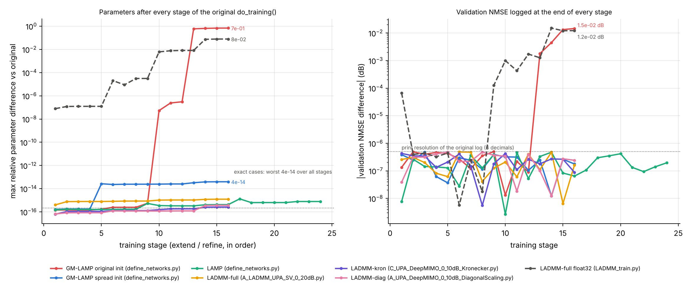
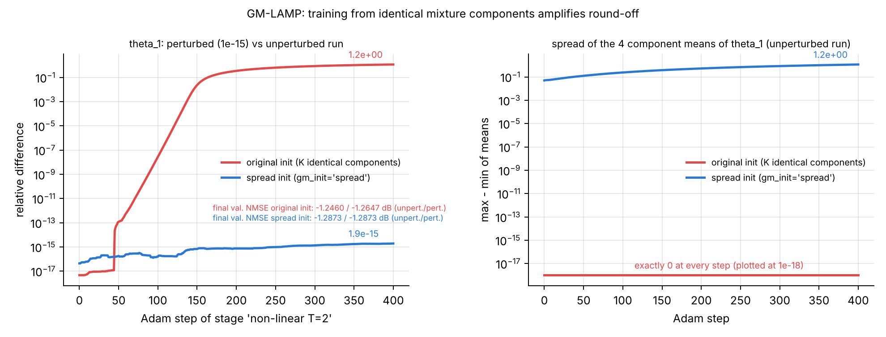
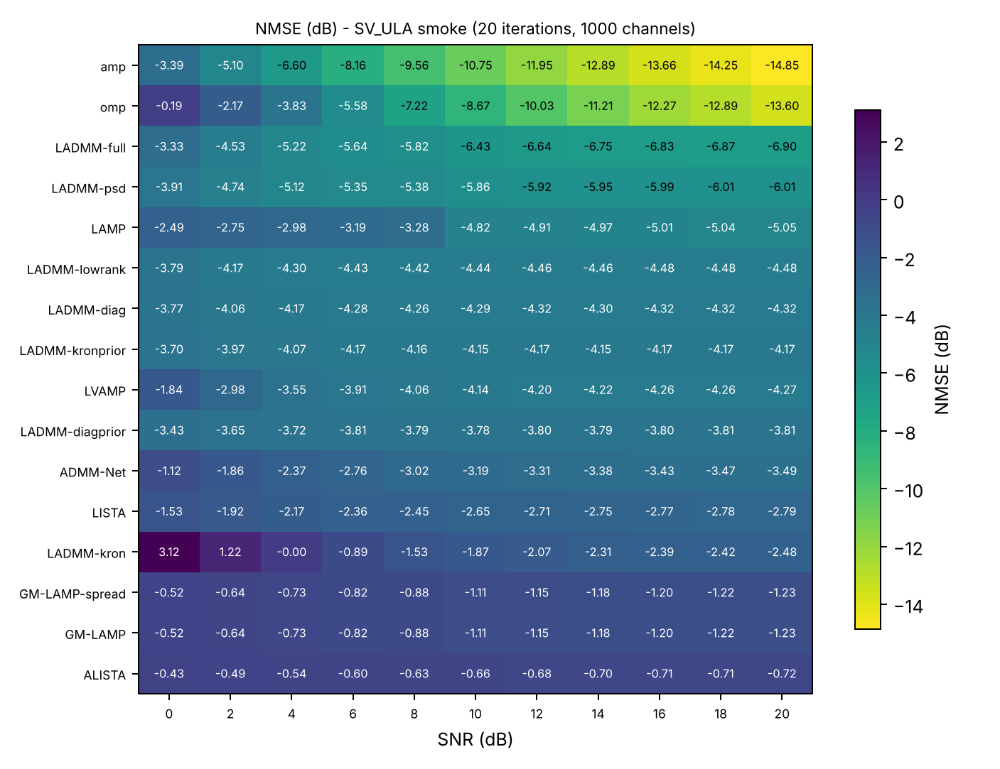

# Verification report — PyTorch ports vs the original code

*bsce, October 2026. All numbers come from `tests/results/equivalence.jsonl` (written by the
pytest suite) and can be regenerated with `python -m pytest tests -q` followed by
`python scripts/summarize_tests.py`.*

## 1. Summary

Every component used in the LADMM project was re-implemented in Python/PyTorch and compared
with the original code run unchanged on identical inputs: MATLAB code in GNU Octave 8.4, the
TF-1 training graphs through `tf.compat.v1` (TensorFlow 2.21, CPU), and THADMM-Net in PyTorch.

| what is compared | worst relative error |
|---|---|
| SV channel generation, CS matrix, measurements (incl. the complete data scripts: 80 000 ULA channels; 220 000 = 100 000 + 10 000 per array for ULA and UPA) | 8.8e-16 (CS matrix and `genMeasurements`: bit-identical) |
| Inference with the trained weights shipped with the code: `LAMP.m`, `GM_LAMP.m` (64 cases), `LADMM_test.m`, `LADMM_UPA_test.m` (16 cases) | 4.6e-15 |
| TF training graphs of LAMP / GM-LAMP and the four float64 LADMM scripts: every layer output, gradients of every stage loss, parameters after Adam steps | 1.7e-13 |
| LISTA, ALISTA (ALISTA repository), LVAMP (Borgerding), float64 copies of the TF code | 3.7e-14 |
| The original `do_training` loops end to end (same minibatches), parameters after every stage: LAMP, GM-LAMP, LADMM full / Kronecker / diagonal | 1.3e-15 (GM-LAMP with the spread initial value: 4.0e-14) |
| Classical AMP / OMP / SD / ADMM vs the `.m` files | 2.9e-14 |
| Exported `.mat` run by `matlab/bsce_infer.m`, and `_orig.mat` run by the unchanged `LAMP.m`, `GM_LAMP.m`, `LADMM_test.m` | 1.4e-15 |
| Code that is float32 in the original (`LADMM_train.py`, ALISTA repo, LVAMP, THADMM-Net) | 1e-5 (single-precision round-off) |

Two results need care when you use the PyTorch training (sections 6 and 7):
GM-LAMP trained from its original initial value is *not* reproducible bit-for-bit by any
implementation (including TF on another device), and float32 training agrees only
statistically. Both are properties of the original method / precision, not of the port.



## 2. How the comparison is done

* **Original code is not edited.** Interventions are limited to (i) Octave shims for
  `rand`, `randn`, `normrnd` that replay a stream of numbers given by the test
  (`tests/harness/octave_shims`), (ii) a module that maps `import tensorflow` to
  `tf.compat.v1` and supplies `tf.contrib.distributions.percentile` for the ALISTA code
  (`tests/harness/tf1_shim.py`), (iii) recording the indices returned by `np.random.choice`
  in the training loops, and (iv) derived copies with Python-3 syntax or float32→float64
  for code that is float32 by design (`tests/harness/make_reference_copies.py`; the copies are
  regenerated from the originals and differ only in those tokens).
* **Inputs**: random SV channels at several SNRs and seeds; for networks, the authors'
  trained weights where they exist, and otherwise the original initial values plus a random
  perturbation (so that no parameter sits at a special value that could hide an error).
* **Metric**: relative Frobenius error ‖a−b‖/‖b‖. With float64 on both sides the expected
  level is 1e-16 … 2e-13 (round-off accumulated through up to 16 layers and Adam steps).
* Most checks run on several seeds / SNRs / arrays (column n of the tables, 1–32 cases per
  check); the suites were run several times while the code was developed. Final full run: **192 passed, 1 skipped by design** (see §11), 58 min on two CPU
  cores (`tests/logs/full_suite.log`).

## 3. Data generation

| check | n | worst rel. error |
|---|---|---|
| SV channels `x = U.'h` vs `generate_channel.m`, ULA / UPA | 5 / 5 | 5.6e-16 / 8.8e-16 |
| `generate_channel_data_for_SV_channel_model.m` (authors', ULA, 80 000 channels) | 1 | 5.4e-16 |
| LADMM-project data script, one run = 220 000 channels (100 000 + 10 000 per array), ULA / UPA | 2 / 2 | 5.5e-16 / 8.7e-16 |
| CS matrix (`generate_CS_matrix.m`) | 3 | 0 |
| measurements with MATLAB-style noise (`Main.m`) | 6 | 5.3e-16 |
| `genMeasurements` (`generate_measurement_data.py`), 3 seeds × 3 SNR bands | 9 | 0 |

The Python generator draws numbers in MATLAB's order (per channel: `normrnd` L, `normrnd` L,
`rand` L [, `rand` L for UPA]; column-major fills); when Octave is given the same uniform /
normal streams it produces the same channels. `scripts/generate_data.py` writes the files
under the original names, so the original training scripts can also read them.

## 4. Inference with the original trained weights

| check | n | worst rel. error |
|---|---|---|
| GM-LAMP vs `GM_LAMP.m` (SV + DeepMIMO, ULA + UPA, 2 bands, several SNRs) | 32 | 4.6e-15 |
| LAMP vs `LAMP.m` | 32 | 1.2e-15 |
| LADMM vs `LADMM_test.m` (ULA, 4 bands) — estimate / per-layer NMSE | 8 | 2.0e-15 / 2.6e-15 |
| LADMM vs `LADMM_UPA_test.m` (UPA, 4 bands) — estimate / per-layer NMSE | 8 | 1.4e-15 / 1.7e-15 |
| LADMM with analytic initialisation vs classical `ADMM_vectorized.m` | 3 | 4.4e-15 |
| proposed LADMM variants (psd / kronprior / diagprior) at initialisation vs classical ADMM | 6 | 4.8e-15 |
| AMP / OMP / SD / ADMM vs `AMP.m`, `OMP.m`, `SD.m`, `ADMM_vectorized.m` | 4 | 9.8e-16 / 4.9e-16 / 5.0e-16 / 2.9e-14 |

## 5. Training graphs (forward, gradients, optimiser)

For each original training script the TF graph is built by the script's own functions
(`build_LAMP` + `setup_training`, `build_LADMM` + `setup_training`, ...). The PyTorch model
gets the same weights; then the test compares (a) every layer output, (b) the stage list
and the variable list of every stage, (c) the gradient of every stage loss with respect to
every variable, and (d) the parameters after several Adam steps of every stage.

| original | precision | outputs | gradients | Adam |
|---|---|---|---|---|
| `define_networks.py`, GM-LAMP (T=8 forward, T=3 all 24 stages) | float64 | 3.8e-16 | 8.1e-15 | 4.9e-14 |
| `define_networks.py`, LAMP (T=8 forward, T=4 all 32 stages) | float64 | 6.1e-16 | 4.0e-16 | 5.0e-15 |
| `A_LADMM_UPA_SV_0_20dB.py` (full H) | float64 | 1.1e-15 | 1.0e-14 | 2.6e-14 |
| `A_UPA_DeepMIMO_0_10dB_DiagonalScaling.py` | float64 | 9.8e-16 | 4.5e-15 | 1.7e-13 |
| `B_UPA_DeepMIMO_0_10dB_LowRank.py` | float64 | 9.7e-16 | 3.0e-14 | 4.7e-15 |
| `C_UPA_DeepMIMO_0_10dB_Kronecker.py` | float64 | 4.4e-16 | 1.6e-14 | 1.7e-13 |
| `LADMM_train.py` (full H) | float32 | 3.1e-07 | 4.4e-06 | 1.0e-05 |
| ALISTA repo, LISTA / ALISTA (float64 copy) | float64 | 4.7e-16 / 4.7e-15 | 2.3e-15 / 1.8e-15 | 3.7e-14 / 0 |
| ALISTA repo, LISTA / ALISTA (original) | float32 | 0 / 0 | 2.7e-06 / 1.7e-07 | 7.7e-06 / 0 |
| Borgerding `LVAMP.py` (float64 copy / original) | 64 / 32 | 9.7e-16 / 4.6e-07 | 1.0e-14 / 5.8e-06 | 1.8e-15 / 4.8e-07 |
| THADMM-Net ADMM-Net (PyTorch) | float32 | 0 | 4.7e-08 | 2.5e-08 |
| ALISTA analytic W vs `CalculateW.m` | float64 | 0 | — | — |

Details that had to be reproduced to reach these numbers: the gradient routing of
`tf.maximum` at ties, TF-1's Adam (Eigen update order; hyper-parameters and the beta-power
accumulators are float32 even in float64 graphs — ignoring this gives 3e-6 instead of 5e-15),
TF's `percentile` with banker's rounding (ALISTA support selection), and the row-major
reshapes of the Kronecker operator.

## 6. Training loops end to end

`tests/test_training_loop_vs_tf.py` runs the original `do_training` loop (data loading,
validation every `iv1` steps before the step, `round(nmse, 5)`, early stopping every
`100·iv1` steps, a fresh Adam per stage, GM-LAMP's warm start of each new layer from the
previous one) on small data (600 training / 100 validation channels, `maxit` 200–300,
`better_wait` 30–40, T = 2–3) and records the minibatch indices it draws and the parameters
it saves after every stage. The bsce `Trainer` is fed the same minibatches.

| case (script) | stages | steps | iteration counts | max NMSE diff. per stage | max param. diff. |
|---|---|---|---|---|---|
| LAMP, T=3 (`define_networks.py`) | 24 | 4216 | all equal | 4.7e-07 dB | 1.3e-15 |
| GM-LAMP, spread initial value, T=2 | 16 | 4816 | all equal | 4.7e-07 dB | 4.0e-14 |
| GM-LAMP, original initial value, T=2 | 16 | 3013 | all equal | 5.0e-07 dB (stages 1–12), 1.5e-02 dB after | 5.6e-16 (stages 1–9), see §7 |
| LADMM full, T=2 (`A_LADMM_UPA_SV_0_20dB.py`) | 16 | 3113 | all equal | 4.8e-07 dB | 1.2e-15 |
| LADMM Kronecker, T=2 (`C_UPA_DeepMIMO_0_10dB_Kronecker.py`) | 16 | 3216 | all equal | 4.3e-07 dB | 2.6e-16 |
| LADMM diagonal, T=2 (`A_UPA_DeepMIMO_0_10dB_DiagonalScaling.py`) | 16 | 3216 | all equal | 4.8e-07 dB | 3.7e-16 |
| LADMM full, T=2 (`LADMM_train.py`, float32) | 16 | 2506 | differ in 1 of 16 stages | 1.5e-02 dB (final 1.2e-02 dB) | 8e-02 |

(NMSE differences below 5e-7 dB are the print resolution of the original log, 6 decimals.)



The float32 run is the expected behaviour of single-precision training: TF and PyTorch
kernels sum in different orders, the 1e-7 differences of the first steps grow, one
early-stop decision flips (stage 12), and the final validation NMSE differs by 0.012 dB. The same
happens between two GPUs or two TF versions. For bit-level comparisons use float64
(`--set model.precision=float64`).

## 7. GM-LAMP: the original initial value makes training depend on round-off

`get_shrinkage_function('gm')` initialises every layer with K = 4 *identical* Gaussian
components (`[1/K; 0; -1e-9]` for every k). With identical components:

* the gradient that would make the components different is exactly zero in exact
  arithmetic; in floating point it is round-off (≈1e-16 for the mixture logits);
* Adam divides by √v, so a round-off-sized gradient produces a non-negligible step, and the
  symmetric state is unstable: a difference of 1e-16 grows by about ×10 every 8–10 Adam steps.

Consequences seen in the tests:

1. In the loop test, PyTorch and TF agree to 5.6e-16 for the first 9 stages. From stage 10
   ('linear T=2 trainrate=0', when the identical-component layer-1 mixture is trained through
   layer 2) the layer-1 mixture parameters `theta_0` differ by up to 3e-7, without a visible
   effect on the output while the components are identical (iteration counts equal, NMSE equal
   to the 6 printed decimals).
   From stage 13 ('non-linear T=2', layer 2 warm-started from layer 1) the components split
   differently in the two codes: parameters differ by O(1), final NMSE by 0.015 dB.
2. Starting PyTorch from TF's state just before stage 13 reproduces TF's split (component
   weights 0.26904 vs 0.26906 after 100 steps), so the port computes the same dynamics; the
   outcome depends only on the last bits of the starting point.
3. `tests/diagnostics/gm_symmetry.py` trains layer 2 twice from the same state, once with one
   mean perturbed by 1 part in 1e15. With the original initial value the two runs end O(1)
   apart (relative difference 1.18) and, in PyTorch on this CPU, the unperturbed run keeps the
   four components exactly identical for all 400 steps (spread of the means = 0). With the
   spread initial value the two runs stay 1.9e-15 apart and the components separate
   (spread 1.16).



The weights shipped with GM-LAMP have clearly different components in every layer (e.g.
layer 1 of the SV-ULA 0–10 dB network: weights 0.89 / 0.00 / 0.01 / 0.09), so in the authors'
run round-off did break the symmetry. Whether and when it breaks is a matter of the
hardware and library, which means a PyTorch GM-LAMP trained from the original value may end
up with (nearly) identical components, i.e. effectively a single-Gaussian denoiser.

**Recommendation.** For GM-LAMP baselines trained with bsce use `configs/train/gmlamp_spread.yaml`
(`gm_init: spread`: means and log-variances offset by 1e-3·linspace(−1, 1, K)). It changes the
initial value by 1e-3, the training is then reproducible (the loop test matches TF to 4e-14
over all stages when both codes get this value), and the components separate through the data.
Keep `gmlamp_original.yaml` for the faithful-reproduction checks, and say in the paper which
initialisation was used.

**v31.1 (18 Oct 2026).** The "may" above was in fact "always" for the default path. `run_suite.py --methods gmlamp`
used `gmlamp_original.yaml`, and in PyTorch the four components got bit-identical gradients from the first step:
measured on the CPU in float32 and float64; a GPU training log shows the same plateau. So every GM-LAMP trained that
way kept a one-Gaussian denoiser. On SV ULA 0–10 dB it reached
−2.93 dB after layer 1, where the authors' log has −9.18 dB.
- The trainer now gives identical components the spread offset before a stage trains them (`train.gm_symmetry: break`,
  the default).
- `keep` is the original arithmetic. The loop test above uses it, and is unchanged.
- `scripts/check_gm_components.py` lists the networks to retrain.
- See `docs/changes/CHANGES_2026-10-18_v31_1_gmlamp_fix.md`.

## 8. Saved models and MATLAB

`save_model` writes `<tag>_<band>.pt` (state dict + config + A + training log),
`<tag>_<band>.mat` (all parameters under the original MATLAB names plus `model`, `A`, `T`,
`cfg_*`; read by `matlab/bsce_load.m` / `bsce_infer.m`) and, for LAMP / GM-LAMP / LADMM,
`<tag>_<band>_orig.mat` with only the variables the original MATLAB functions read.

| check | n | worst rel. error |
|---|---|---|
| `.pt` and `.mat` reload in Python; `.mat` through `bsce_infer.m` in Octave — all 13 model types | 26 | 1.4e-15 |
| `_orig.mat` copied to the original file name and run by the unchanged `LAMP.m`, `GM_LAMP.m`, `LADMM_test.m` (LADMM full, Kronecker, proposed kronprior) | 10 | 7.5e-16 |

`_orig.mat` exists because the original functions call `load(...)` inside the function: a
weight file that also contains `A` or `T` silently replaces the function's own `A`/`T`
(this is what happens in `LADMM_UPA_test.m`, see §9).

## 9. Findings about the original code

1. **GM-LAMP initial value** — identical mixture components; training outcome depends on
   round-off (§7).
2. **TF-1 Adam in float64 graphs** keeps `beta1`, `beta2`, `epsilon`, the learning rate and the
   beta-power accumulators in float32. Any re-implementation that uses float64 constants
   differs by ≈3e-6 per step.
3. **Kronecker LADMM** (`C_UPA_DeepMIMO_0_10dB_Kronecker.py`): the code computes
   `(H2 ⊗ H1) x` (row-major reshape), whereas the docstring says `H1 ⊗ H2`. bsce reproduces
   the code; for the paper, write the operator the code implements.
4. **LADMM `alpha_{T-1}`** of the last layer never receives a gradient (the last dual update
   does not reach the output); it stays at its initial value 1. Harmless, but it is counted as
   a parameter.
5. **Validation rounding**: GM-LAMP and the LADMM scripts compare `round(nmse, 5)`; with small
   NMSE (high SNR, NMSE < 1e-3) 5 decimals are only 2–3 significant digits; ties count as "no
   improvement" (`argmin` keeps the first), so early stopping can trigger earlier than the
   unrounded NMSE would. bsce reproduces it (`val_round: 5`); the fair
   protocol uses `val_round: null`.
6. **`LADMM_UPA_test.m`** hard-codes the depth per SNR range (T = 5 / 4 / 5 / 5) *before*
   `load(...)`; the DeepMIMO weight file used for range 1 contains a variable `T = 6`, which
   silently overrides the 5 (ranges 2–4 keep 4 / 5 / 5).
7. **DeepMIMO MATLAB evaluation**: `A` is stored in single precision in the DeepMIMO
   `CSmatrix_128256.mat`, so `A*x` and everything after it is computed in single precision
   (≈1e-7 relative). The tests convert `A` to double.
8. **`genMeasurements`** leaves trailing all-zero columns when the number of channels is not
   divisible by the number of SNR chunks; bsce raises an error (`strict=False` reproduces the
   original).
10. **Low-rank LADMM initialisation is ill-defined** (`B_UPA_DeepMIMO_0_10dB_LowRank.py`): P, Q
   are built from the top-r singular vectors of W = (AᵀA + I)⁻¹, but the largest singular value
   (= 1) has multiplicity N − M = 128 (the null space of A). Which 16 vectors LAPACK returns is
   arbitrary and differs between MKL (Windows) and OpenBLAS (Linux); the stored golden run differs
   by 0.28 % in validation NMSE between the two. Runs on one machine are exact.
9. **Uploaded DeepMIMO LADMM weights**: with the DeepMIMO test channels and
   `CSmatrix_128256.mat` shipped with the GM-LAMP code they give an NMSE of about 0 dB (ULA) and
   −0.7 … −1.4 dB (UPA) at 2–17 dB SNR, i.e. they were trained with another sensing matrix or
   other data. The bit-level tests do not depend on this (they compare two implementations
   with the same weights), but the DeepMIMO results should be regenerated once your DeepMIMO
   data are uploaded.

## 10. Pipeline check on CPU (smoke run)

`python scripts/run_all.py --scenario configs/scenarios/sv_ula.yaml --smoke` generated a tiny SV-ULA data set
(1000 / 200 / 200 channels), trained all 14 configurations for both SNR bands (`--smoke`:
`maxit` 20, T ≤ 2), evaluated them together with AMP and OMP at 11 SNRs (the same noise for
all methods, the band network chosen by SNR), and reloaded every saved model
(`scripts/check_exports.py`). The NMSE values are **not** performance results — 20 iterations
on 1000 channels — they only show that every path of the pipeline runs on the CPU.

| trained models | `.pt` vs `.mat` reloaded in Python | Octave `bsce_infer.m` vs PyTorch |
|---|---|---|
| float64 (LAMP, GM-LAMP, GM-LAMP-spread, LADMM diag / low-rank / Kronecker) | 0 | ≤ 1.6e-15 |
| float32 (LADMM full / psd / kronprior / diagprior, LISTA, ALISTA, LVAMP, ADMM-Net) | 0 | ≤ 6.7e-6 (PyTorch runs in single, MATLAB in double) |

`.mat` files store float64 arrays even for float32-trained networks, so MATLAB evaluates them
in double precision (finding 7 in §9 is the same issue in the original DeepMIMO files).



A second file, `tests/test_golden.py`, trains 13 configurations (every model and LADMM operator
except GM-LAMP with the original initial value, whose training is round-off sensitive, §7) for a
few iterations in float64 (PyTorch only, ~50 s) and compares with numbers stored in `tests/golden/golden.json`; two
consecutive runs on this machine gave bit-identical results. Run it on your GPU machine
(`python -m pytest tests/test_golden.py`; the GPU is used automatically) to check the installation there
(tolerance 1e-7 on GPU, because GPU kernels sum in a different order).

## 11. Not covered / limits

* The training *loops* of the ALISTA repository (`utils/train.py`), Borgerding's LVAMP and
  THADMM-Net were not replayed end to end: their data come from in-graph random generators or
  data loaders that cannot be fed the same minibatches without editing them. Their per-stage
  operations (forward, gradients, Adam, stage lists) are verified (§5), and the schedule code
  they share with GM-LAMP/LADMM is covered by §6; the ALISTA schedule (step before validation,
  per-variable decay) is a port of `utils/train.py` checked by reading, not by a replay.
* LISTA, ALISTA and LVAMP are real-valued in their repositories. bsce adds a complex mode for
  beamspace channels (real weights on Re/Im, shrinkage on |·| with the phase kept). For
  LISTA/ALISTA the complex mode on real inputs equals the original real code (2.3e-15). For
  LVAMP the complex mode uses the circular complex Bernoulli-Gaussian prior (with the Wirtinger
  divergence), which is a different model from the real prior, so that check does not apply
  (the one skipped test); LVAMP's real mode is the part verified against Borgerding's code.
* No GPU was available here; all comparisons with the original code used PyTorch on the CPU.
  `tests/test_gpu_vs_cpu.py` closes the chain on the GPU machine: for all 14 model
  configurations, in float64 and float32, it runs the same weights, inputs and minibatches on the
  CPU and the GPU and compares every stage output, every stage gradient, 5 Adam steps per stage,
  a short training run (iteration counts, NMSE, final parameters) and the exported `.pt`/`.mat`.
  Tolerances: float64 1e-12 (outputs), 1e-10 (gradients), 1e-9 (Adam), 1e-8 (trained parameters,
  identical early-stop decisions); float32 at single-precision level and NMSE within 0.1 dB.
  Then |GPU − original| ≤ |GPU − CPU| + |CPU − original|. Here the file was only dry-run with
  `BSCE_GPU_DEVICE=cpu` (code path check). TF32 is disabled on CUDA so float32 matmuls stay in
  full single precision. GM-LAMP from the original initial value is compared only statistically
  in training (§7).
* DeepMIMO: scenario files are prepared (`configs/scenarios/deepmimo_*.yaml`); the data will be
  produced with `generate_data.py --measurements-only` once the channels are uploaded.

## 12. Reproduce

```bash
python -m pytest tests -q                          # all checks (Octave + TensorFlow needed)
python tests/diagnostics/gm_symmetry.py            # §7 figure
python scripts/summarize_tests.py                  # tables and figures in tests/results/
python scripts/run_all.py --scenario configs/scenarios/sv_ula.yaml --smoke   # §10
python -m pytest tests/test_gpu_vs_cpu.py tests/test_golden.py -q   # on the GPU machine
```
