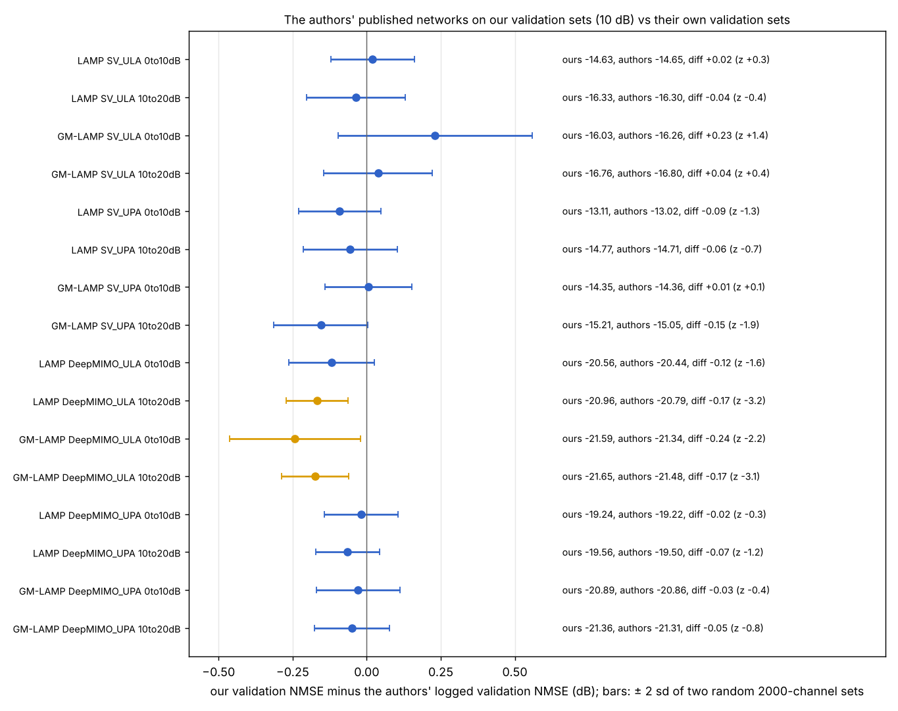
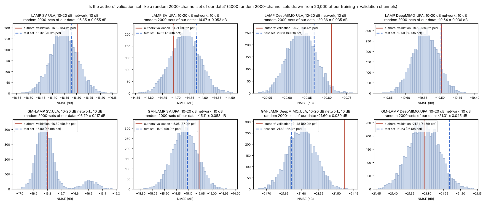
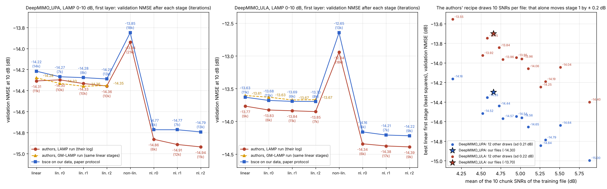

# bsce against the authors' code: data and training protocol (GM-LAMP, Wei–Hu–Dai, IEEE TCOM 2021)

*15 Oct 2026. Inputs:*
- *the authors' package `Deep learning for beamspace channel estimation in millimeter-wave massive MIMO systems.zip`;*
- *the raw DeepMIMO files `H_ula.mat` and `H_upa.mat`.*

*Every number below was measured in this session. The scripts are in `scripts/check_vs_authors.py` and `docs/authors_check/audit/`.*

## Summary

1. **Data.** bsce's GM-LAMP data sets follow the authors' code item by item.
   - The two raw files give exactly the data used for all earlier results (fingerprints `4 x OK`).
   - 1990 / 2000 (ULA) and 1991 / 2000 (UPA) of the authors' own DeepMIMO test channels are found among the users, to 1e-5.
   - Measurement files: the noise power of every chunk, re-estimated from y − Ax with the authors' matrix, matches the stored SNR within 0.016 dB.
   - The authors' 16 published networks, run on our validation sets, give the validation NMSE the authors logged within −0.24 … +0.23 dB. For 13 of the 16 the difference is within the spread of two random 2000-channel sets.
2. **Training protocol.** `--protocol paper` (LAMP, GM-LAMP) and `--protocol gmlamp` (any method) are the authors' `do_training`.
   - This was earlier shown to be exact: parameters after every stage equal the TensorFlow original to ≤ 1.3e-15 (`tests/results/summary.md`).
   - Here, the first layer was retrained on our data (DeepMIMO UPA and ULA, LAMP) and compared with the authors' own training logs.
     - Every stage moves as in the authors' log, and the stage lengths match (86k vs 91k, 73k vs 83k iterations).
     - The validation NMSE is 0.03–0.30 dB higher. That is within the authors' own run-to-run spread: their two runs of the same stages differ by up to 0.20 dB.
     - Their unseeded draw of the 10 chunk SNRs alone moves stage 1 by ±0.21 dB.
3. **New: the fair comparison on the authors' terms.** Every method can be trained with the authors' protocol and data (GUIDE 4.8):
   ```
   %run scripts/run_suite.py --scenarios all --methods ladmm6 ladmm4 lamp8 gmlamp8 nfladmmsr4 --protocol gmlamp --train-snr scenario --ft-snr none
   ```
   The workbench has it as step 4, "Every method with the authors' protocol".
   - Precision: float32 for every method by default. Add `model.precision=float64` (a select in the workbench) to be exact.
4. **What the authors' package does not contain.** There is no DeepMIMO data script: the ReadMe points to DeepMIMO.net and to the SV script. The training scripts are written for the SV file names.
   - bsce's DeepMIMO path is `matlab/deepmimo_make_H.m` + `scripts/deepmimo_convert.py`. It reproduces the authors' DeepMIMO test file user by user, so the convention is the authors'. Their training/validation split is not public, so ours is a seeded random split of the remaining users.

## 1. What is in the authors' package

| folder | content | used by bsce for |
|---|---|---|
| `Train Network/` | `generate_channel_data_for_SV_channel_model.m`, `generate_channel.m`, `generate_CS_matrix.m`, `generate_measurement_data.py`, `define_networks.py`, `define_shrinkage.py`, `Train_LAMP.py`, `Train_GM-LAMP.py`, `load_trained_network.py`, `Trained_Networks/*.npz` | the data recipe, the network, the training loop; the `.npz` training states (weights + log of every stage) are the reference of the checks below |
| `CE for SV Channel Model/` | `Main.m` (test), `GM_LAMP.m`, `LAMP.m`, `AMP.m`, `OMP.m`, `CSmatrix256128.mat`, 8 trained networks | the test procedure, the SV CS matrix, the published SV networks |
| `CE for DeepMIMO Dataset/` | `Main.m`, `CSmatrix_128256.mat`, `ULA_test_channel.mat`, `UPA_test_channel.mat`, 8 trained networks | the DeepMIMO CS matrix (a different matrix from the SV one: only 50 % of the signs agree), the DeepMIMO test sets, the published DeepMIMO networks |
| `Other Results/` | SNR-range, convergence, complexity and sum-rate figures | – |

The 16 `.npz` training states hold exactly the weights of the 16 published `.mat` networks (difference 0 for every B_t and θ_t). Their logs are therefore the training histories of the published networks:
- 64 stages each (8 layers × 8 stages);
- 0.68–1.33 million iterations in total;
- shortest stage 6000 iterations in all 16, longest 277,000;
- no stage reached the 10⁶ limit.

## 2. Data: the authors against bsce

| item | the authors | bsce (`make_gmlamp_data.py`, `configs/scenarios/*.yaml`) | status |
|---|---|---|---|
| SV channels | `generate_channel.m`: L = 3, d = λ/2, α ~ CN(0, 1). ULA: φ ~ U(−π/2, π/2). UPA: φ₁, φ₂ ~ U(−π/2, π/2), a₁ ⊗ a₂. h = √(N/L) Σ α a | `bsce/data/sv.py` | identical (vs `generate_channel.m`: 5.6e-16 ULA, 8.8e-16 UPA) |
| SV beamspace | x = U_Nᵀh, centred DFT; UPA: kron(U₁₆, U₁₆) | the same | identical |
| SV sizes | training S = 80,000 (`generate_channel_data…m`); test K = 2000 fresh channels per run (`Main.m`); the validation size is not in the package | 80,000 / 2,000 / 2,000, fixed seeds | as the paper; a fixed test set instead of fresh channels |
| DeepMIMO channels | not in the package. Paper Table I: O1_28, BS 3, rows 1000–1300, 3 paths, λ/2, one subcarrier | the uploaded files: `O1_28, BS 3, rows 1000–1300, num_paths 3, spacing 0.5, OFDM_limit 1`. ULA: `num_ant_z = 256`; UPA: `num_ant_y = num_ant_z = 16`. 54,481 users | the authors' test channels are found in these users: 1990 / 2000 (ULA), 1991 / 2000 (UPA), median relative error 2.4e-5 / 9.9e-6 |
| DeepMIMO beamspace | not in the package; their test file implies x = U₀ᴴh with ‖x‖² = N (found by matching users, 13 Oct) | `deepmimo_convert.py` | identical convention (fidelity 0.99999999996) |
| DeepMIMO sizes | paper: 50,000 / 2,000 / 2,000; test = `<ARR>_test_channel.mat` | the authors' test file; its users removed; 50,000 / 2,000 drawn (seed 2026) from the other 52,481 | same sizes and test set; our own train/val split (theirs is not public) |
| CS matrix | SV `CSmatrix256128.mat` (double); DeepMIMO `CSmatrix_128256.mat` (single) | the same files, per data set | identical |
| training measurements | `genMeasurements`: y = A(x + n), n ~ CN(0, σ²I_N), σ² = 10^(−SNR/10); 10 equal chunks, one SNR ~ U(band) each | the same: 10 chunks, SNR stored per column | identical recipe; our 10 SNRs are seeded (theirs unseeded) |
| validation | one file at 10 dB for both networks | one file per band, both at 10 dB (two noise draws) | statistically identical |
| bands | 0–10 dB and 10–20 dB networks | the scenario bands (`--train-snr scenario`) | identical |
| test | `Main.m`: SNR 0:5:20, fresh noise, the 0–10 dB network below 10 dB, the 10–20 dB network from 10 dB | `evaluate.py`: SNR 0:2:20, fixed noise (the same for every method), the same rule | same rule, more points, reproducible noise |

### 2.1 Measured: measurement files (all four data sets, both bands)
- Training files: 10 chunks with SNR (dB) 9.10, 0.63, 9.28, 0.21, 6.38, 7.33, 1.50, 1.19, 5.85, 5.14 (0–10 dB) and 13.56, 11.87, 17.80, 11.31, 18.93, 11.83, 13.38, 16.94, 13.46, 12.08 (10–20 dB), all inside the band.
- Validation files: 10 dB.
- **The SNR re-estimated from y − Ax** (E‖An‖² = σ²N) differs from the stored SNR by at most 0.016 dB.
- **The noise is A·n with n white in the beam domain**, as `generate_measurement_data.py`: the empirical covariance of y − Ax matches σ²AAᵀ (correlation of the off-diagonal entries 0.968 over 2000 columns; circular to 2 %).
- **The right matrix is used:** with the other data set's A, the "noise" would be 3–4 dB stronger than the signal.

### 2.2 Measured: the published networks on our validation sets
"Authors" is the validation NMSE logged at the end of their training (their validation set, 10 dB). "Ours" is the same network on our validation file (10 dB). sd is the sampling spread of a 2000-channel NMSE (bootstrap); z = difference / (√2 sd).

| network | authors (dB) | ours (dB) | diff (dB) | z |
|---|---|---|---|---|
| LAMP SV_ULA 0–10 / 10–20 | −14.655 / −16.297 | −14.635 / −16.333 | +0.02 / −0.04 | +0.3 / −0.4 |
| GM-LAMP SV_ULA 0–10 / 10–20 | −16.260 / −16.799 | −16.029 / −16.760 | +0.23 / +0.04 | +1.4 / +0.4 |
| LAMP SV_UPA 0–10 / 10–20 | −13.023 / −14.711 | −13.114 / −14.767 | −0.09 / −0.06 | −1.3 / −0.7 |
| GM-LAMP SV_UPA 0–10 / 10–20 | −14.356 / −15.054 | −14.350 / −15.209 | +0.01 / −0.15 | +0.1 / −1.9 |
| LAMP DeepMIMO_ULA 0–10 / 10–20 | −20.443 / −20.788 | −20.562 / −20.957 | −0.12 / −0.17 | −1.6 / −3.2 |
| GM-LAMP DeepMIMO_ULA 0–10 / 10–20 | −21.343 / −21.475 | −21.585 / −21.649 | −0.24 / −0.17 | −2.2 / −3.1 |
| LAMP DeepMIMO_UPA 0–10 / 10–20 | −19.223 / −19.496 | −19.241 / −19.561 | −0.02 / −0.07 | −0.3 / −1.2 |
| GM-LAMP DeepMIMO_UPA 0–10 / 10–20 | −20.862 / −21.308 | −20.891 / −21.358 | −0.03 / −0.05 | −0.4 / −0.8 |



**DeepMIMO ULA** is the only data set where the difference is larger than chance (ours ~0.17 dB easier). To find out whose set is unusual, the authors' 10–20 dB networks were run on 5000 random 2000-channel sets drawn from 20,000 of our channels:
- **Our validation channels are typical:** 33rd–40th percentile with fresh noise. The validation file happens to have an easy noise draw: −1.5 sd of the noise-to-noise spread, 0.037 dB.
- **The authors' validation set is harder than almost every random set:** 98th (LAMP) and 99.9th (GM-LAMP) percentile.
- **Their test set is typical:** 22nd–81st percentile.
- **On SV and DeepMIMO UPA, all of their sets are typical:** validation sets at the 20th–90th percentile, test sets at the 57th–96th.



So the authors' DeepMIMO ULA validation set is about 0.1 dB harder than a random set of 2000 users from the same area would be. It may be chance, or a few users differ: 10 of their 2000 test channels are not found exactly in DeepMIMO v1.3. Either way it does not affect the comparison:
- the test set is the authors' own file;
- the validation set only decides when a training stage stops;
- every method is validated on the same file.

## 3. Training protocol: the authors against bsce

| item | the authors (`define_networks.py`, `Train_*.py`) | bsce (`gmlamp_original.yaml`, `lamp_original.yaml`, `gmlamp_protocol.yaml`, `bsce/train/trainer.py`) | status |
|---|---|---|---|
| network | `build_LAMP`, untied, T = 8; B_t = Aᵀ/(1.01‖A‖₂²); θ init LAMP (1, 1), GM [1/K, 0, −1e-9] with K = 4; Onsager terms b, c (with the conjugate term) | `bsce/models/lamp.py` | identical (forward 3.8e-16, gradients 8e-15 vs the TF graph) |
| loss | batch NMSE: mean‖x̂ − x‖² / mean‖x‖² | `loss: nmse` | identical |
| stages | per layer: linear (B_t) at lr 1e-3, then all variables at 1e-3 × {0.5, 0.1, 0.01}; non-linear (θ_t) the same; 64 stages for T = 8 | `schedule: borgerding`, `refinements: [0.5, 0.1, 0.01]` | identical (the same stage names) |
| optimizer | a new `tf.train.AdamOptimizer` per stage | `adam_tf1`, a new optimizer per stage | identical (Adam step 4.9e-14) |
| warm start | the new layer's variables are set to the trained previous layer's | `warm_start: true` | identical |
| minibatch | 128, `np.random.choice` with replacement; y from the file (noise fixed) | `batch_size: 128`, with replacement, `noise: file` | identical |
| validation | every 10 iterations on the whole validation set, `round(nmse, 5)` | `ivl: 10`, `val_round: 5` | identical |
| stopping | checked every 1000 iterations: stop when the best is older than 5000 (shortest stage 6000); at most 10⁶ | `check_mult: 100`, `better_wait: 5000`, `maxit: 1000000` | identical |
| weights kept | the last ones | `restore_best: false` | identical |
| precision | float64 (`tf.float64`, `complex128`) | paper protocol: float64; `gmlamp` protocol: float32 for every method (option float64) | identical with `--protocol paper`, or with `model.precision=float64` |
| bands | two networks, each validated at 10 dB | `--train-snr scenario` | identical |

**Exactness.**
- **Loop:** the bsce loop fed the same minibatch indices as the TensorFlow `do_training` gives the same parameters after every stage, to 1.3e-15 (LAMP) and 5.6e-16 (GM-LAMP) (`tests/test_training_loop_vs_tf.py`, earlier session).
- **Merged config:** for LAMP and GM-LAMP, `--protocol gmlamp` differs from `--protocol paper` only in the precision. The merged configs were compared key by key.

### 3.1 Measured: retraining the first layer on our data against the authors' logs
`train.py --protocol original --bands 0to10dB --set model.T=1` (8 stages; GM-LAMP: the 4 linear stages), DeepMIMO, CPU, against the first 8 stages of the authors' log of the same network (their data, their validation set):

| stage | UPA: bsce | UPA: authors' LAMP run | UPA: authors' GM-LAMP run | ULA: bsce | ULA: authors' LAMP run | ULA: authors' GM-LAMP run |
|---|---|---|---|---|---|---|
| linear T=1 | -14.216 (14k) | -14.309 (11k) | -14.279 (9k) | -13.631 (11k) | -13.768 (9k) | -13.606 (8k) |
| linear, refinement 0.5 | -14.269 (7k) | -14.298 (10k) | -14.332 (13k) | -13.680 (13k) | -13.827 (6k) | -13.630 (8k) |
| linear, refinement 0.1 | -14.277 (8k) | -14.333 (10k) | -14.359 (9k) | -13.695 (6k) | -13.838 (11k) | -13.673 (7k) |
| linear, refinement 0.01 | -14.290 (13k) | -14.357 (10k) | -14.352 (6k) | -13.697 (8k) | -13.851 (7k) | -13.669 (7k) |
| non-linear T=1 | -13.850 (18k) | -13.939 (21k) | – | -12.646 (13k) | -12.944 (18k) | – |
| non-linear, refinement 0.5 | -14.773 (6k) | -14.864 (6k) | – | -14.161 (6k) | -14.343 (6k) | – |
| non-linear, refinement 0.1 | -14.773 (7k) | -14.913 (12k) | – | -14.209 (7k) | -14.376 (17k) | – |
| non-linear, refinement 0.01 | -14.794 (13k) | -14.936 (11k) | – | -14.220 (9k) | -14.390 (9k) | – |
| total iterations | 86,000 | 91,000 | | 73,000 | 83,000 | |

(GM-LAMP's first four stages are the same computation as LAMP's: the linear part B₀y. The bsce GM-LAMP run gave
exactly the bsce LAMP values above, −14.216 / −14.269 / −14.277 / −14.290 dB with 14k / 7k / 8k / 13k iterations, as it
must with the same seed. The GM-LAMP non-linear stages take about 0.1 s per iteration on this CPU and were not run.)



**Agreement.**
- **Stage lengths:** the same range. bsce 6k–18k (UPA) and 6k–13k (ULA) per stage; the authors 6k–21k and 6k–18k.
- **Totals:** 86k vs 91k iterations (UPA), 73k vs 83k (ULA).
- **Every stage moves the same way in both codes**, including the jump at the start of the non-linear stage. That jump comes from the warm start and the first threshold.
- **The values differ by +0.03 to +0.14 dB (UPA) and +0.14 to +0.30 dB (ULA)** against the authors' LAMP run; bsce is slightly worse.

**Why the values differ: the authors' recipe itself is random by this much.**
1. **The authors' own two runs disagree.** Their LAMP and GM-LAMP runs compute the same first four stages on the same data set and differ only in their random draws. They disagree by up to 0.03 dB (UPA) and 0.16–0.20 dB (ULA). On DeepMIMO ULA, the bsce stages lie within 0.03 dB of their GM-LAMP run.
2. **The 10 chunk SNRs alone move stage 1 by ±0.21 dB.** `generate_measurement_data.py` draws 10 SNRs per training file, unseeded. The least-squares optimum of the first stage on our channels was computed for 12 other draws of the 10 SNRs: the validation NMSE moves with sd 0.21 dB (UPA) and 0.22 dB (ULA). It follows the mean of the draw (correlation −0.92).
3. **Our files' draw is on the low side.** Its mean is 4.66 dB against the expected 5, which explains why our stage 1 is a little worse.
4. **bsce's training reached that optimum.** The trained linear stage is within 0.01 dB of the least-squares value for our files (−14.290 vs −14.297; −13.697 vs −13.699).

So bsce trains as the authors do. The remaining differences are of the size that the authors' recipe gives between two of its own runs. For the paper:
- **Between methods trained in bsce:** this randomness cancels, because every method uses the same files.
- **Against the authors' published networks:** differences of a few tenths of a dB are within it.

## 4. The fair comparison on the authors' terms (new)

| what | command | folders |
|---|---|---|
| every method, the authors' protocol and data | `run_suite.py --scenarios all --methods ladmm6 ladmm4 lamp8 gmlamp8 nfladmmsr4 --protocol gmlamp --train-snr scenario --ft-snr none` | `<method>-T<T>_gmlamp_trscenario` |
| the same in float64, as the authors | add `--set model.precision=float64` | `…_gmlamp_trscenario_precision-float64` |
| compare (with the published GM-LAMP and LAMP) | `compare.py --scenarios all --tags "*_gmlamp_trscenario*" --name authors_protocol` | `results/authors_protocol/` |
| check the data | `check_vs_authors.py` | `results/authors_check/` |
| check a paper-protocol retraining stage by stage | `check_vs_authors.py --no-data --runs "outputs/*/LAMP-T8_paper_trscenario" "outputs/*/GM-LAMP-T8_paper_trscenario"` | `results/authors_check/stages_*.png` |

- **Smoke check here:** all four methods (LADMM, LAMP, GM-LAMP, NF-LADMM-SR) trained under this protocol in float64.
  - The README of each run lists `protocol gmlamp`, `precision float64` and `noise file`.
  - Each method gets two networks per data set.
- **NF-LADMM** gets the noise variance of every column from the `snr_db` of the measurement files.

### 4.1 Variants of the data (options, defaults = the authors / as before)

| option | the authors | variant | flag |
|---|---|---|---|
| validation noise | one file at 10 dB for both networks | over the whole band, SNR ~ U(band); or other fixed SNRs | `--val-snr range`, `--val-snr 0 5 10` |
| edges | each network trained exactly on its band (0–10, 10–20) | trained on [lo − M, hi + M], used on [lo, hi] | `--margin M` (`--ft-margin M` for the fine-tune) |
| SNR chunks per training file | 10 | 100 (finer, covers the band and its margins evenly) | `--snr-chunks 100` |

With only 10 chunks, a band is covered coarsely and randomly. Our 0–10 dB training file has the SNRs 0.21, 0.63, 1.19, 1.50, 5.14, 5.85, 6.38, 7.33, 9.10 and 9.28 dB: nothing between 1.5 and 5.1 dB. This is the authors' recipe (their own draws were unseeded); it is also why their draw alone moves a network by about ±0.2 dB (3.1). For a variant with edge margins, use `--snr-chunks 100`, so the margins are actually sampled.

## 5. Remaining differences (all statistical, none systematic)
1. **Random draws are seeded in bsce** and unseeded in the authors' code: the SV channels, the 10 training-chunk SNRs, the noise and the minibatches.
2. **Validation files:** bsce writes one per band (two noise draws at 10 dB); the authors use one file for both.
3. **DeepMIMO training/validation users:** a seeded random split of the users outside the authors' test set; their split is not public.
4. **Test procedure:** a fixed SV test set and fixed test noise at 0, 2, …, 20 dB, against fresh channels and noise at 0, 5, …, 20 dB. The rule for choosing the network by SNR is the same.
5. **`--protocol gmlamp`** trains in float32 unless `model.precision=float64` is given.

## 6. Files
- `scripts/check_vs_authors.py` (new), `tests/test_check_vs_authors.py` (new).
- `scripts/train.py`: `train_log.json` now has the `stage_log` of every band (stage, validation NMSE, iterations), as the authors' log.
- `app/bsce_app.py`: three new workbench tasks:
  - step 2, "Check the data against the authors' files";
  - step 2, paper retraining → "compare every training stage with the authors' training logs";
  - step 4, "Every method with the authors' protocol".
  - Also a step-5 preset: "trained with the authors' protocol".
- `GUIDE.md` 1, 2.2 and 4.8.
- `tests/proposals/`: the NF-LADMM reference modules, which the NF-LADMM tests need. They were in `reference/proposals/`, which is not shipped.
- `docs/authors_check/`: the figures and tables of this report, and `audit/`, the stand-alone scripts used.
