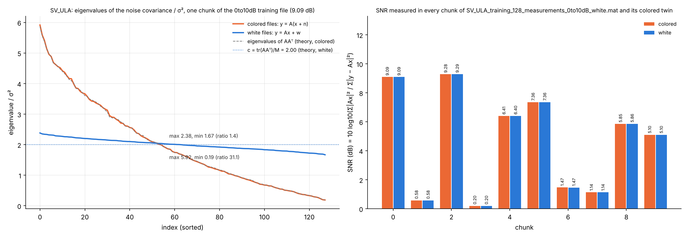
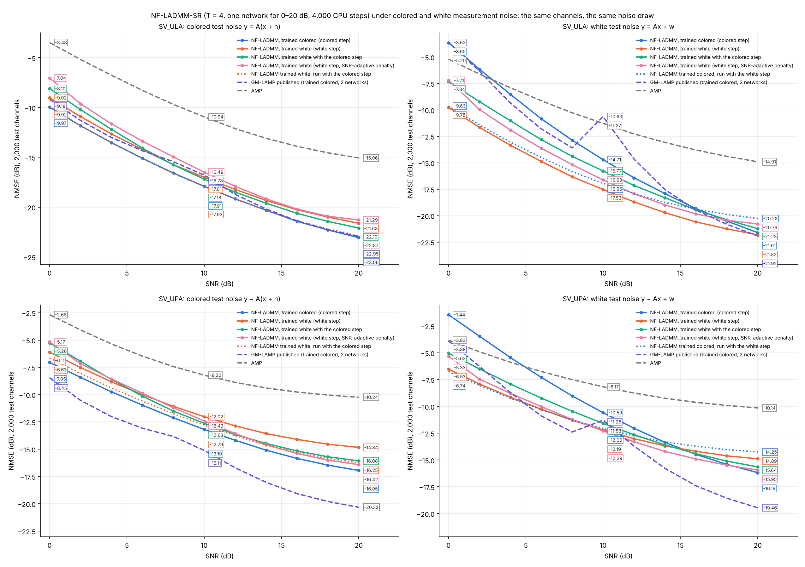

# Colored and white measurement noise in bsce (v23)

*16 Oct 2026. The commands are in GUIDE 4.10 and every option is in MANUAL 3.3b. This page covers the definitions, the
checks, and the NF-LADMM smoke test. Its figures, numbers and code are in `docs/noise_check/`.*

## 1. The two noise models
| noise model | measurements | noise covariance | used by |
|---|---|---|---|
| `colored` (default) | y = A(x + n), n ~ CN(0, σ²I_N) | σ² AAᵀ | GM-LAMP and all bsce results up to v22 |
| `white` | y = Ax + w, w ~ CN(0, cσ²I_M), c = tr(AAᵀ)/M | cσ² I | UTRR and most other papers |

**Definitions.**
- **SNR:** σ² = 10^(−SNR/10) in both models.
- **Equal power:** E‖w‖² = E‖An‖² = σ² tr(AAᵀ). At the same SNR the two models have the same signal Ax and the same mean noise power at the measurements; only the colour of the noise differs.
- **The constant c:** for GM-LAMP's ±1/√M combiner, c = N/M = 2. The eigenvalues of AAᵀ spread over 0.19 … 5.87 (condition number 31).
- **UTRR's own white model** fixes ‖Ax‖²/‖w‖² for every channel. bsce keeps that definition only in `utrr_reproduce.py`.

**Paired draws.** bsce makes the white noise from the colored draw:

  w = T A n,  T = √c (AAᵀ)^(−1/2),  so  y_white = Ax + T(y_colored − Ax).

- **Exactly white:** T AAᵀ Tᵀ = cI, so w is exactly white Gaussian.
- **Paired:** every white file, validation set and test set has the same channels and the same random numbers as its colored twin. A difference between the two models comes from the noise colour alone.
- **The colored path is untouched:** every colored file and result is bit-identical to v22.

**Why white noise is harder at the same SNR.**
- **Colored noise:** the row-space least-squares estimate A⁺y has noise A⁺An, the projection of n, with power σ²M.
- **White noise:** the same estimate has noise A⁺w, which the small eigenvalues of AAᵀ amplify, with power cσ² tr((AAᵀ)⁻¹).
- **For this A,** the ratio is **2.0 (3.0 dB)**.
- **Priors narrow the gap:**
  - a genie LMMSE, which knows every |xᵢ|², loses 0.15–0.5 dB (ULA) and 0.3–0.7 dB (UPA) under white noise;
  - NF-LADMM loses 0.2–1.3 dB (ULA) and 0.5–2.1 dB (UPA) in section 4.

## 2. NF-LADMM's data step for each noise model
The x-step is the exact proximal map of the likelihood, x = v + Aᵀ(AAᵀ + ρ̃ Σ̃)⁻¹(y − Av), with Σ̃ = Σ/σ² and ρ̃_t = 1/β_t − 1:

| `model.noise_model` | Σ̃ | x-step |
|---|---|---|
| `colored` | AAᵀ | x = v + β_t A⁺ (y − Av) (as before) |
| `white` | cI | x = v + Aᵀ U diag(1/(λᵢ + κ_t)) Uᵀ (y − Av), κ_t = c ρ̃_t, with AAᵀ = U diag(λ) Uᵀ |

**Properties.**
- **Parameters:** the same in both rows, so a trained network can be run with either step (`evaluate.py --nf-step matched`).
- **Training:** `train.py` builds the step of the data's noise model.
- **Mismatch on purpose:** `--set model.noise_model=colored` on white data.
- **Cost:** the white step is O(M² + MN) per layer, from one M×M eigendecomposition per combiner.

**Option `model.white_step=adaptive`.** κ_t,b = c ρ̃_t σ_b²/0.1, the prox of an ADMM with a fixed penalty: the step tends to A⁺ at high SNR and regularises more at low SNR. Section 4 measured it; the default stays `normalized` (κ_t independent of the SNR).

## 3. Checks
**Unit and pipeline tests** (`tests/test_noise_model.py`, 10 tests, all pass):
- **The whitening map:** T AAᵀ Tᵀ = cI to 10⁻¹⁰, and the mean power is preserved.
- **Generators:**
  - the colored output is unchanged;
  - the white output is the same draw whitened, to 10⁻¹²;
  - the MATLAB-style test draw itself is unchanged.
- **Statistics** over 40,000 draws:
  - every white variance equals cσ² within 5 %;
  - the white entries are uncorrelated;
  - the colored noise has an eigenvalue spread above 10;
  - the mean power is equal within 2 %.
- **Validation sets and files:**
  - the white file made from its colored twin equals the transform of the twin;
  - `snr_db` is copied;
  - the validation file made without a twin is paired with the colored file made later.
- **NF-LADMM:**
  - the white step equals the closed form to 10⁻¹⁰;
  - its gradient-of-objective test is below 10⁻⁹, and so is the colored step's;
  - it adds no saved state, and files without `noise_model` load as colored;
  - the step can be switched.
- **Trainer:** the online white minibatch is the colored one whitened.
- **Pipeline:**
  - `train.py` with both models, in file mode, writes `<scenario>_white_smoke` and paired files;
  - `evaluate.py` detects white automatically;
  - `compare_noise.py --nf-matched` produces every combination.

**The data (SV ULA).** The white files were made from the authors' colored files with `make_sv_measurements.py --noise-model white` (`docs/noise_check/white_data_check.png`):

| check | result |
|---|---|
| paired | max \|y_w − Ax − T(y_c − Ax)\| = 9 × 10⁻¹⁶ (all four files) |
| SNR of every chunk, colored vs white | equal within 0.01 dB (e.g. 9.09 / 9.09, 0.58 / 0.58, … dB) |
| eigenvalues of the noise covariance / σ² | colored 0.19 … 5.92, the eigenvalues of AAᵀ (ratio 31.1); white 1.67 … 2.38 around c = 2 (ratio 1.4, which is the spread of a white sample covariance from 8,000 columns) |



## 4. NF-LADMM smoke test under both noise models
**Setup.**
- **Network:** NF-LADMM-SR (the suggested variant), T = 4, one network for 0–20 dB; 3,350 parameters for the ULA, 8,982 for the UPA.
- **Training:** its own end-to-end training (`--protocol paper`) shortened to **4,000 steps on a CPU** (the default is 30,000), batch 128, online noise.
- **Test:** the 2,000 test channels, with the same noise draw for both models.
- **Reference:** the published GM-LAMP (two networks, trained with colored noise) and AMP.
- **Networks:**

  | name | trained on | data step |
  |---|---|---|
  | **C** | colored | colored |
  | **W** | white | white |
  | **Wc** | white | colored |
  | **Wa** | white | white, adaptive |

- **The same weights with the other step:** "C, white step" and "W, colored step".

**SV ULA**, NMSE in dB at 0 / 10 / 20 dB and the mean over the 11 test SNRs:

| network | colored test | mean | white test | mean |
|---|---|---|---|---|
| C: trained colored | **−9.97 / −17.91 / −23.06** | **−17.38** | −3.65 / −14.71 / −21.61 | −13.87 |
| W: trained white (white step) | −9.02 / −17.01 / −21.63 | −16.36 | **−9.78 / −17.53 / −21.82** | **−16.87** |
| Wc: trained white, colored step | −8.10 / −17.18 / −22.10 | −16.34 | −7.34 / −15.77 / −21.23 | −15.19 |
| Wa: trained white, adaptive white step | −7.04 / −16.49 / −21.29 | −15.69 | −7.21 / −16.63 / −20.79 | −15.68 |
| C run with the white step | – | – | −9.63 / −16.95 / −20.28 | −16.14 |
| W run with the colored step | −9.92 / −17.93 / −22.87 | −17.35 | – | – |
| GM-LAMP published (trained colored) | −9.18 / −16.78 / −22.95 | −16.87 | −3.63 / −10.63 / −21.92 | −13.61 |
| AMP | −3.48 / −10.94 / −15.06 | −10.27 | −5.20 / −11.27 / −14.91 | −10.80 |

**SV UPA:**

| network | colored test | mean | white test | mean |
|---|---|---|---|---|
| C: trained colored | −7.05 / −13.19 / −16.95 | −12.73 | −1.44 / −10.59 / −16.18 | −9.88 |
| W: trained white (white step) | −6.11 / −12.02 / −14.84 | −11.40 | −6.53 / −12.19 / −14.89 | −11.61 |
| Wc: trained white, colored step | −5.26 / −12.63 / −16.08 | −11.83 | −5.03 / −11.58 / −15.64 | −11.10 |
| Wa: trained white, adaptive white step | −5.17 / −12.42 / −16.42 | −11.85 | −5.33 / −12.29 / −15.95 | −11.72 |
| C run with the white step | – | – | −6.74 / −12.06 / −14.25 | −11.43 |
| W run with the colored step | −6.63 / −12.79 / −16.25 | −12.27 | – | – |
| GM-LAMP published (trained colored) | **−8.45 / −15.11 / −20.32** | **−15.18** | **−3.89 / −11.28 / −19.46** | **−12.58** |
| AMP | −2.68 / −8.22 / −10.24 | −7.50 | −3.83 / −8.17 / −10.14 | −7.70 |



**Findings.** In the gains below, a positive value means better (lower NMSE).

1. **The exact white step pays when training on white data** (W against Wc, white test):
   - SV ULA: +1.68 dB on average, +2.4 dB at 0 dB, +1.8 dB at 10 dB, +0.6 dB at 20 dB.
   - SV UPA: +0.5 dB on average, +1.5 dB at 0 dB, +0.6 dB at 10 dB, but −0.75 dB at 20 dB.
2. **A network on the other noise loses up to 6 dB, and switching its data step recovers most of it without retraining:**

   | network | test | loss as trained | with the test's step |
   |---|---|---|---|
   | C | white, ULA | 3.0 dB (6.1 dB at 0 dB) | 0.73 dB |
   | C | white, UPA | 1.73 dB | 0.18 dB |
   | W | colored, ULA | 1.01 dB | **0.02 dB** |
   | W | colored, UPA | 1.32 dB | 0.46 dB |

   - The loss is measured against the network trained on the test's own noise.
   - For comparison, the published GM-LAMP loses 3.25 dB (ULA) and 2.6 dB (UPA) on white noise, and 6.2 dB at 10 dB, where its 10–20 dB network takes over. It has no data step to switch.
3. **On SV ULA, NF-LADMM leads under both noise models.** It has 3,350 parameters, one network and 4,000 CPU steps:
   - colored: −17.38 dB against −16.87 dB for the published GM-LAMP, i.e. +0.51 dB (two networks, 262k parameters each);
   - white: −16.87 dB against −13.61 dB, i.e. +3.26 dB; run with the white step without retraining, it still gains +2.53 dB.
   - At 20 dB on white noise the two are level (−21.82 against −21.92).
4. **On SV UPA, this short budget is not enough.** NF-LADMM is 2.45 dB behind the published GM-LAMP on colored noise and 0.97 dB behind on white. The UPA network was still improving, and the proposal's pilot already showed that the 2-D prior needs more training. This is not a result on the UPA, only a smoke test.
5. **White noise is harder:**
   - NF-LADMM loses 0.5 dB (ULA) and 1.1 dB (UPA) on average against colored noise at the same SNR;
   - the loss grows with the SNR (1.25 / 2.06 dB at 20 dB);
   - the reason is the amplification of section 1.
6. **The SNR-adaptive penalty (`white_step=adaptive`) does not help in general:**
   - SV ULA: worse at every SNR, by 1.19 dB on average;
   - SV UPA: +0.11 dB on average, better from 12 dB up (+1.06 dB at 20 dB) but worse below (−1.21 dB at 0 dB).

   So `normalized` stays the default. A learned exponent, κ_t ∝ (σ²)^γ_t with γ_t between the two, is the natural next step.

**Limits.**
- Short CPU training (4,000 of 30,000 steps), one seed, T = 4.
- The authors' GM-LAMP had its full training. The comparison with it is indicative, and must be redone with `run_suite.py` on the GPU.

**The generic comparison of the same runs.** `compare_noise.py` writes it, including the mismatch loss at every SNR: `docs/noise_check/noise_comparison.png`, `noise_summary.csv` / `.md`.

## 5. Reproduce
From the bsce folder (about 1 h 15 min on 2 CPU cores; less on a GPU with `--device cuda`):
```
sh docs/noise_check/code/run_nf_noise_smoke.sh 4000 "sv_ula sv_upa"   # C, W, Wc for both arrays + compare_noise.py
sh docs/noise_check/code/run_adaptive.sh                               # Wa, then compare_noise.py again
python docs/noise_check/code/plot_nf_noise_smoke.py results_noise/nf_noise_smoke/noise_summary.csv docs/noise_check
python docs/noise_check/code/check_white_data.py . configs/scenarios/sv_ula.yaml docs/noise_check
```
In Spyder, the same lines run with `%run scripts/run_suite.py ...` (see the `.sh` files).

**For the paper.** The same commands on the GPU without `train.steps`, for every method and data set:
```
%run scripts/run_suite.py --scenarios all --methods nfladmmsr4 ladmm6 gmlamp8 --noise-model white --device cuda
%run scripts/compare_noise.py --scenarios all --tags "*_ft_*" --nf-matched
```
