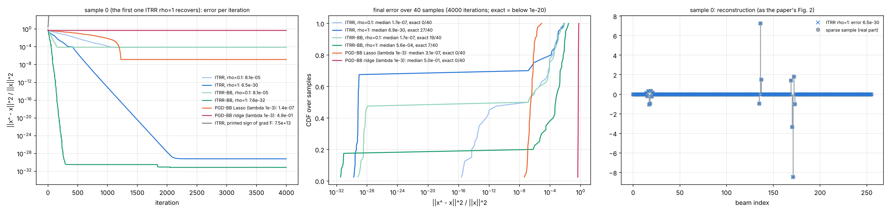
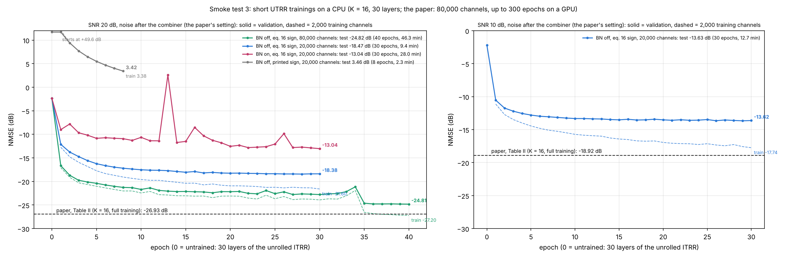

# UTRR in bsce: implementation from the paper, and its smoke tests

**What.**
- **The method:** UTRR (unfolded trimmed-ridge regression) of P. Wu, J. Cheng, Y. C. Eldar and J. M. Cioffi, "Learned Trimmed-Ridge Regression for Channel Estimation in Millimeter-Wave Massive MIMO", IEEE TCOM 73(2):1128–1141, Feb. 2025 (DOI 10.1109/TCOMM.2024.3440875; arXiv 2408.02934).
- **Why it matters:** it reports the best published NMSE on exactly bsce's SV ULA setup (N = 256, M = 128, ±1/√M combiner, 80k/2k/2k).
- **Code:** none was published. bsce's version is written from the paper alone.

**Status.**
- **The equations are verified:**
  - ITRR (the iterative algorithm) recovers exactly sparse vectors to machine precision, as in the paper's Figs. 2–4.
  - The network at initialisation is the unrolled iteration, to the last bit.
- **Trained on a CPU, in the paper's setting:** with 13 % of the paper's maximum budget (all 80,000 channels, 40 of up to 300 epochs, 2 of 5 learning rates), UTRR reached **−24.82 dB at 20 dB** against the paper's −26.93 dB, and was still improving (section 4.3).
- **Before UTRR numbers go into the paper**, reproduce Table II on the GPU with `scripts/utrr_reproduce.py` (section 6).

---

## 1. The method (from the paper)

**Trimmed-ridge regression** (Sec. II-B, eq. 12):

  min_x ½‖y − Φx‖² + ρ (‖x‖² − ‖x‖²_{K,2}),   ‖x‖²_{K,2} = sum of the K largest squared entries.

The penalty is the ridge penalty with the K largest entries left out. It is zero exactly when x is K-sparse, and it
does not shrink the large entries.

**ITRR** (Algorithm 1, Sec. III):
- **Splitting:** x = u − v with u = (x)₊, v = (−x)₊, so z = [u; v] ≥ 0, and A = [Φ, −Φ].
- **Update (DC programming):**
  - ∇F(z) = Aᵀ(Az − y) + 2ρ(z − z̄_K), where z̄_K is z with only its K largest entries kept;
  - z ← (z − ∇F(z)/(k + 2ρ))₊, with k ≥ λ_max(AᵀA).
- **BB variant (eq. 21–22):**
  - w ← (z − α_t∇F)₊ and z ← z + β_t(w − z);
  - α_t is the Barzilai–Borwein step, and β_t = t/(t + 3).

**UTRR** (Sec. IV, Fig. 6, Algorithm 2, eq. 23):
- **Initial layer:** x⁽⁰⁾ = Φᵀy, z⁽⁰⁾ = [(x⁽⁰⁾)₊; (−x⁽⁰⁾)₊].
- **Each layer t = 0 … L − 1:**
  - g = A_tᵀ(A_t z − y) + ρ_t (z − z̄_K⁽ᵗ⁾);
  - w = ReLU(z − α_t g);
  - z ← (w + z)/2.
- **Output:** x̂ = u⁽ᴸ⁾ − v⁽ᴸ⁾.
- **Trainable:** A_t ∈ ℝ^{M×2N}, initialised to [Φ, −Φ]; ρ_t, initialised to 1; α_t, initialised to 0.1.
  - In total L(2MN + 2) = 1,966,140 parameters for L = 30, M = 128, N = 256.
- **RCC (Sec. IV-B):** K = 0 in the layers 0 … L − 2, and top-K only in the last layer. In Table I this halves training time at no loss: −26.93 dB with RCC against −26.78 dB without.
- **UTRR-E (Sec. IV-D):** the mean of four UTRR models with K = 0, 16, 64, 256.
- **The paper's setting (Sec. V-A):**
  - Data: SV ULA channels, real and imaginary parts as two real samples; 80,000 / 2,000 / 2,000 channels.
  - Measurement: z = Φh + n, with **noise after the combiner** and SNR = E[‖Φh‖²/‖n‖²].
  - Training: 30 layers; learning rates 0.005, 0.001, 0.0005, 0.0002, 0.0001; early stopping after 10 epochs; at most 300 epochs; batch 128.
- **Table II (NMSE, dB):**

| | K = 0 | K = 16 | K = 64 | K = 256 | UTRR-E |
|---|---|---|---|---|---|
| M = 128, SNR 10 dB | −18.92 | −18.92 | −19.00 | −18.77 | −22.06 |
| M = 128, SNR 20 dB | −26.97 | −26.93 | −26.73 | −26.94 | −30.18 |
| M = 64, SNR 20 dB | −21.89 | −21.22 | −21.72 | −21.45 | −24.51 |

---

## 2. What bsce has

| file | what it is |
|---|---|
| `bsce/models/utrr.py` | the network (method key `utrr`, `configs/train/utrr.yaml`) |
| `bsce/models/ensemble.py`, `scripts/make_ensemble.py` | UTRR-E, or an average of any trained networks |
| `scripts/utrr_reproduce.py` | Table II in the paper's own setting (noise after the combiner), one model per SNR and K, then UTRR-E |
| `tests/test_utrr.py`, `tests/proposals/utrr_ref.py` | the tests, and the standalone reference implementation written from the paper (also ITRR) |
| `bsce/train/trainer.py` | `end2end` + `lr_list` (staged learning rates) + `patience` (early stopping); loss `mse` |

**Commands** (`GUIDE.md` 4.9):
```
%run scripts/utrr_reproduce.py --snr 20 --K 0 16 64 256 --device cuda
%run scripts/run_suite.py --scenarios all 3gpp --methods utrr --protocol paper --device cuda
%run scripts/run_suite.py --scenarios all 3gpp --methods utrr --protocol paper --set model.K=0 --device cuda   (and 64, 256)
%run scripts/make_ensemble.py --runs outputs/SV_ULA/UTRR-T30_paper_K-0_ft_0-10-20dB_20k outputs/SV_ULA/UTRR-T30_paper_ft_0-10-20dB_20k outputs/SV_ULA/UTRR-T30_paper_K-64_ft_0-10-20dB_20k outputs/SV_ULA/UTRR-T30_paper_K-256_ft_0-10-20dB_20k --tag UTRR-E-T30_paper_ft_0-10-20dB_20k
```
- **`--protocol paper`** is UTRR's own end-to-end training of `configs/train/utrr.yaml`. The suite then fine-tunes it per band, as every other method.
- **Under the common layer-wise protocol (`ladmm_best`)** UTRR trains too, but its 30 layers × 5 stages take days.
- **`--methods all`** does not include UTRR; it runs only when named.

---

## 3. Where the paper is ambiguous or wrong, and what bsce does

| # | point | the paper | bsce | why |
|---|---|---|---|---|
| 1 | sign of the data gradient | Algorithm 1/2 and Fig. 6 print ∇F = Aᵀ(**y − Az**) + … | Aᵀ(**Az − y**) + … (eq. 16, DC programming) | The printed form is the gradient of −½‖y − Az‖². ITRR with it diverges: error 6×10¹³ after 60 iterations. The derived form reproduces Figs. 2–4 (4.1). Option `sign="paper"` in the reference. |
| 2 | batch normalisation | Fig. 6 draws BN after z⁽⁰⁾ and in every layer, before the ReLU. Algorithm 2 and the parameter count L(2MN + 2) have none. | **No BN** by default; `--set model.bn=true` adds it as drawn (batch statistics in training, running statistics in test) | In the short trainings, BN reached −13.04 dB and no BN −18.47 dB, on the same data and budget (4.3). |
| 3 | batch | "128" | 128 real samples = 64 complex columns (`batch_size: 64`) | The paper stacks real and imaginary parts as separate samples (footnote 3). |
| 4 | optimizer | not named | Adam (PyTorch) | Usual choice; the learning-rate values fit Adam. |
| 5 | "diminishing learning rates" | 0.005, 0.001, 0.0005, 0.0002, 0.0001; early stopping after 10 epochs; at most 300 epochs | One stage per rate, in this order. Each stage runs until 10 epochs without improvement and continues from its best weights. 300 epochs in all. | The only reading that uses all three statements. |
| 6 | data normalisation | "each channel sample is normalised" (target not given) | bsce's SV data as GM-LAMP's (E‖x‖² = N) | NMSE does not depend on the scale; without BN the network is positively homogeneous in y. |
| 7 | SV parameters | number of clusters and LoS gain not given | GM-LAMP's generator (`data/SV_ULA`, L = 3) | The same data as every other method in bsce. |
| 8 | noise placement | after the combiner (z = Φh + n) | `utrr_reproduce.py`: the paper's. The suite: bsce's y = A(x + n), as for every method. | Reproduce first, then compare under one noise model. |
| 9 | training SNR | one model per SNR (Table II) | `utrr_reproduce.py`: one per SNR. The suite: a 0–20 dB network, then the fine-tune per band, as for every method. | |
| 10 | ITRR ρ, BB fallback | ρ "tuned"; α_t when the BB denominator ≤ 0 not given | ρ = 1 (and 0.1); fallback 1/(k + 2ρ); β_t = t/(t + 3) | Section 4.1 |
| 11 | RCC with layer-wise training | — | The top-K term sits in the last layer *in use*, so the network after layer t is exactly a (t + 1)-layer UTRR. | Needed by `--save-layers` and `promote_layer.py`; tested. |

---

## 4. Smoke tests (this session)
- **Code:** `docs/utrr_check/code/`, from the bsce folder. For example:
  ```
  python docs/utrr_check/code/smoke1_itrr.py . results/utrr_smoke
  python docs/utrr_check/code/smoke3_train.py . results/utrr_smoke --snr 20 --bn 0 --ntrain 80000 --epochs 40 --patience 4
  ```
- **Results:** the json files and the console log are in `docs/utrr_check/`.

### 4.1 ITRR on exactly sparse samples (the paper's Sec. III-C, Figs. 2–4)
**Setup:**
- 40 SV ULA test channels, with all but the 16 largest beams set to zero; real part.
- Noiseless y = Φx with GM-LAMP's CS matrix; 4,000 iterations, K = 16.
- Code: `smoke1_itrr.py`.

| method | median final error ‖x̂ − x‖²/‖x‖² | exact (< 10⁻²⁰) | paper (one sample) |
|---|---|---|---|
| ITRR, fixed step, ρ = 1 | **6.9×10⁻³⁰** | **27 / 40** | 8.2×10⁻³⁰ |
| ITRR-BB, ρ = 0.1 | 1.7×10⁻⁷ | 19 / 40 | ~10⁻³¹ |
| ITRR-BB, ρ = 1 | 5.6×10⁻⁴ | 7 / 40 | |
| ITRR, fixed step, ρ = 0.1 | 1.7×10⁻⁷ | 0 / 40 | |
| PGD-BB Lasso (λ = 10⁻³) | 3.1×10⁻⁷ | 0 / 40 | 4.8×10⁻⁶ |
| PGD-BB ridge (λ = 10⁻³) | 0.50 | 0 / 40 | 0.496 |
| ITRR with the printed sign | 6×10¹³ after 60 iterations | 0 / 40 | — |



**Reading:**
- **ITRR as implemented reproduces the paper's figures:** exact recovery to about 10⁻³⁰, at about 2,200 iterations with the fixed step and about 300 with BB steps. The paper reports about 2,500 and 600.
- **It reaches exact recovery on most samples, not all:** the problem is non-convex, and the remaining samples stop at a critical point. The paper itself notes that "the iteration … lacks a theoretical guarantee of convergence to the optimal solution".
- **Lasso and ridge land where the paper puts them:** about 10⁻⁶ and 0.5.

### 4.2 The network is the paper's equations
`smoke2_net.py`; `tests/test_utrr.py` repeats these checks on every run.

| check | result |
|---|---|
| forward at initialisation (no BN) = 30 iterations of eq. 23 in NumPy (float64) | max difference **0.0** |
| parameters without BN = L(2MN + 2) | 1,966,140 = 1,966,140; with BN 1,997,884 |
| every parameter gets a gradient | yes (none missing) |
| forward(upto = t) = a separate (t + 1)-layer network | difference 0.0 |
| complex columns = real and imaginary parts as real samples | difference 0.0 |
| bsce model = the standalone reference, perturbed weights, BN on and off, batch and running statistics | difference 0.0 |
| untrained network (30 layers of unrolled ITRR) on SV ULA at 20 dB | −2.35 dB |
| CPU time (2 cores), 128 real samples: forward / training step | 22 ms / 121 ms |

### 4.3 Short trainings in the paper's setting (noise after the combiner)
`smoke3_train.py`: K = 16, 30 layers, Adam with the paper's learning rates, early stopping after 4 epochs (10 in the
paper), loss E‖x − x̂‖², batch 128 real samples. SV ULA data of bsce; the test set is the 2,000 standard test channels.

| SNR | BN | gradient sign | training channels | epochs (last rate) | best val. | **test NMSE** | 2,000 training ch. at the end | minutes | paper (K = 16) |
|---|---|---|---|---|---|---|---|---|---|
| 20 dB | no | eq. 16 | 80,000 | 40 (0.001) | -24.81 | **-24.82** | -27.20 | 46.3 | -26.93 |
| 20 dB | no | eq. 16 | 20,000 | 30 (0.005) | -18.44 | **-18.47** | -21.60 | 9.4 | -26.93 |
| 20 dB | yes | eq. 16 | 20,000 | 30 (0.0005) | -13.04 | **-13.04** | – | 28.0 | -26.93 |
| 20 dB | no | printed | 20,000 | 8 (0.005) | 3.42 | **3.46** | 3.38 | 2.3 | -26.93 |
| 10 dB | no | eq. 16 | 20,000 | 30 (0.005) | -13.66 | **-13.63** | -17.74 | 12.7 | -18.92 |



**Reading:**
- **Without BN UTRR trains much better.** At 20 dB, on the same 20,000 channels and budget, test NMSE was -18.47 dB without BN against -13.04 dB with the BN of Fig. 6. With BN the validation also jumped up and down at the first learning rate.
- **With the printed sign of the data gradient it does not train:** +3.46 dB after 8 epochs.
- **Most of the gap to the paper is training data and budget.**
  - **20,000 channels overfit:** at the end the training channels were 3.2 dB (20 dB) and 4.1 dB (10 dB) better than the validation channels. These runs used 2.5 % of the paper's maximum budget (80,000 channels × 300 epochs).
  - **On all 80,000 channels the test NMSE reached −24.82 dB at 20 dB** after 40 epochs (13 % of that budget).
    - That is 2.1 dB short of the paper's −26.93 dB.
    - It already lies beyond GM-LAMP's level on these channels (−22.95 dB, with noise before the combiner).
  - **That run was still improving** when its budget ended. The step from the first to the second learning rate alone gave 2.0 dB (−22.79 → −24.81 dB validation), and three more rates were left.
- **So this is a working implementation, close to the paper, but not yet a reproduction.** Table II has to be reproduced on the GPU with the full schedule (section 6).

### 4.4 In bsce
- **`tests/test_utrr.py`: 9 passed.** Its checks:
  - against the reference, at initialisation and in parameters;
  - truncation and `.pt` / `.mat` round trips, BN statistics included;
  - the stage plan;
  - ITRR exact recovery, and divergence with the printed sign;
  - the trainer's `lr_list` / `patience` / `mse` options, and `end2end` unchanged for ADMM-Net;
  - `run_suite`;
  - the ensemble and `make_ensemble.py`.
- **Pipeline on tiny data (`--smoke`, CPU):**
  - `run_suite.py --methods utrr ladmm2` (common layer-wise protocol) and `--methods utrr --protocol paper`: the training and the fine-tune per band ran.
  - `compare.py`: UTRR appears in the comparison table and figures.
  - `--save-layers` → `depth_snapshots.py`: the network saved after layer 3 gives the same test NMSE as the final 3-layer network.
- **`utrr_reproduce.py` on 1,000 channels:**
  - two models, the ensemble and the table were written;
  - a second call resumed from the checkpoint.

---

## 5. Cost

| | UTRR (one model) | UTRR-E | LADMM T = 6 | GM-LAMP |
|---|---|---|---|---|
| parameters | 1,966,140 | 7.9 M | 393,234 | 262,240 |
| real multiplications per channel estimate | ≈ 7.9 M (2 real samples × 30 layers × 2 · M · 2N) | ≈ 31 M | ≈ 0.85 M | ≈ 1 M |

- **One CPU epoch** (2 cores), no BN: about 17 s for 20,000 channels and 70 s for 80,000. With BN, 20,000 channels take 30 s.
- **On a GPU:** the paper reports 255 min per model on an RTX A6000. The P2000 is slower, so expect several hours per model.

---

## 6. What to do on the GPU

1. **Reproduce first:**
   ```
   %run scripts/utrr_reproduce.py --snr 20 --K 0 16 64 256 --device cuda
   ```
   - **Within about 1 dB of −26.9 dB per model** (and about −30 dB for the ensemble): the implementation is confirmed, and UTRR can be used as the reference.
   - **Clearly short of it:** try `--bn 1`, the BN of Fig. 6. In the short CPU runs here BN trained worse, but the full budget may differ.
   - **Then ask the authors for their code:** the corresponding author is J. Cheng.
2. **Then compare in bsce's setting**, with the other methods, on every data set (`GUIDE.md` 4.9).
3. **In the paper:**
   - State that UTRR was re-implemented from the paper, the reproduction result, and points 1–2 of section 3.
   - Report UTRR with the same noise model and protocol as the other methods.
   - Give its parameter count and multiplications next to the NMSE.
